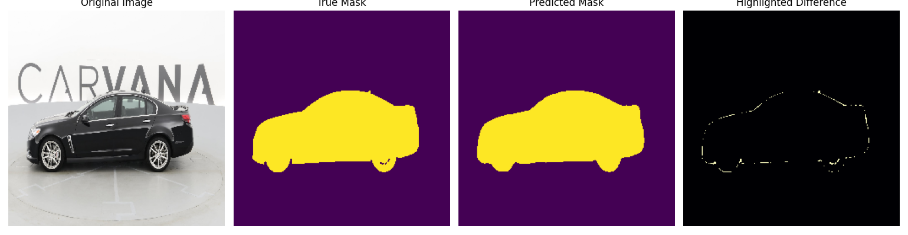

# Vehicle Image Segmentation

A computer vision project from my internship at Visea İnovatif.
The goal was to generate a pixel-level mask that separates a vehicle
from its background.

## Project workflow

- Prepared paired vehicle images and segmentation masks.
- Applied data augmentation, including rotation, to the images and masks.
- Trained and evaluated segmentation models.
- Generated and visualized predicted masks on sample images.

## Example output

## Main scripts

| Script | Purpose |
| --- | --- |
| `dataset_loader.py` | Loads images and their corresponding masks |
| `task2_offline_aug.py` | Generates augmented images and masks |
| `task2_train.py` | Trains the segmentation model |
| `task2_evaluate.py` | Evaluates model predictions |
| `task2_inference.py` | Generates masks for input images |
| `task2_visualize.py` | Visualizes segmentation results |

Training requires a labeled image and mask dataset. Inference requires
compatible trained model weights.
